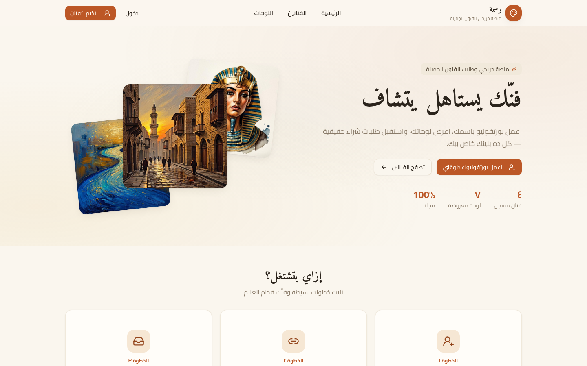

# 🎨 Rasma

**A gallery platform for fine-arts graduates — create, upload, and finally get seen.**

## 📖 Overview

Rasma gives fine-arts graduates what school never did: an audience. Artists register for free, build their gallery and upload original artworks, while visitors browse featured artists and a public wall of displayed pieces. The interface borrows its warmth from real galleries — cream paper, terracotta accents, and the artwork first, everything else second.

## ✨ Features

- 👤 **Free artist accounts** with personal galleries
- 🖼️ **Public artwork wall** and featured-artist selections
- 🪜 **Three-step journey** — create your account, upload, get seen
- 📊 **Live community stats** — artists, artworks, availability
- 🏛️ **Warm gallery-inspired art direction**

## 🧱 Tech Stack

`Next.js` · `Community` · `Auth` · `Galleries` · `Arabic RTL`

## 🌐 Live Product

**Try it now:** [https://rasma1.vercel.app/](https://rasma1.vercel.app/)

---

Built by **[Hamza Talal](https://github.com/{USERNAME})** — 15-year-old full-stack developer from Egypt

